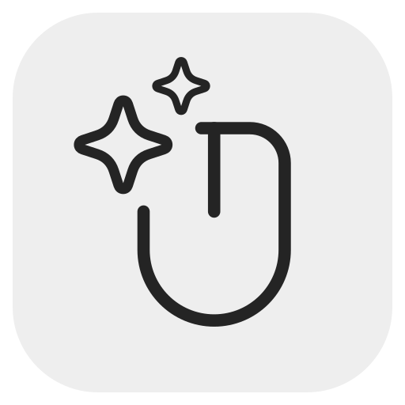
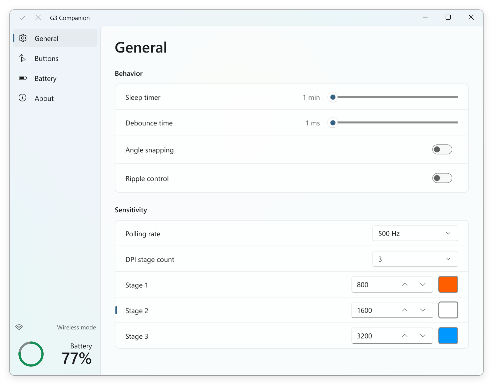
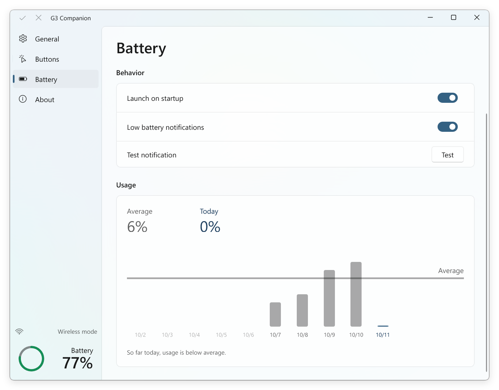
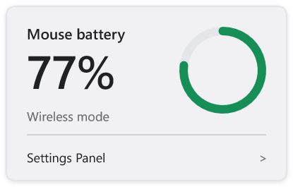
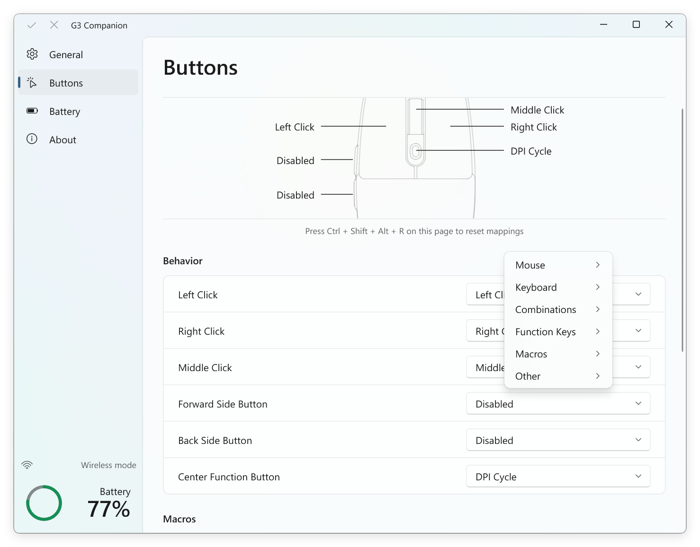
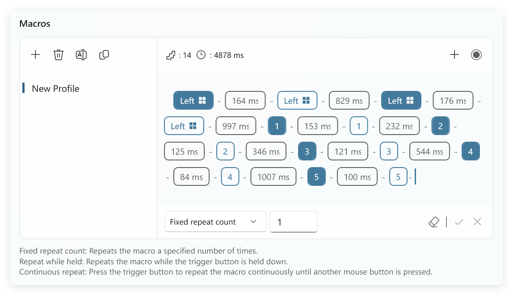

<p align="center">
  
</p>

<h1 align="center">G3 Companion</h1>

<p align="center">A third-party management utility tailored for MCHOSE G3.</p>
<p align="center">Mouse settings, button mappings, macros, and battery monitoring in a WinUI 3 interface.</p>

<p align="center">
  
  
  
</p>

<p align="center">
  <a href="README.md">English</a> · <a href="README.zh-CN.md">简体中文</a>
</p>

<p align="center">
  <a href="https://github.com/SsenNChan/G3-Companion/releases">Download</a> ·
  <a href="#features">Features</a> ·
  <a href="#getting-started">Getting started</a> ·
  <a href="#build-from-source">Build from source</a>
</p>



## Features

### Battery monitoring

Battery monitoring is a signature feature of G3 Companion, absent from the original software. It brings tray battery status, low battery notifications, and daily usage statistics together.

Keep your mouse's battery status in the system tray. Enable launch on startup and low battery notifications from the Battery page.

View daily battery usage over the past ten days, with today's consumption and an average for comparison.



<p align="center">
  
</p>

### Button mappings

Assign mouse actions, keyboard keys, shortcuts, function keys, or macros to the six mouse buttons. The mouse diagram shows each button's current assignment, and the function menu groups actions by category.



### Macro editing

Compared with the original software, G3 Companion offers a simpler, more intuitive macro editing workflow. Key events and delays appear as a visual sequence, with recording, editing, and profile management in one editor for a smoother experience.

Record keyboard and mouse actions, edit events and delays, and create, rename, or duplicate macro profiles. Assign a profile to a mouse button and choose how it repeats:

- **Fixed repeat count** — run the macro a specified number of times.
- **Repeat while held** — repeat while holding the trigger button.
- **Continuous repeat** — repeat until another mouse button is pressed.



### Macro clock compensation (experimental)

Macro clock compensation is an experimental feature exclusive to G3 Companion. It grew out of macro testing that revealed inaccuracies in the mouse's internal clock: actual execution intervals differed from the delays set in the editor, and the timing difference accumulated over longer sequences.

Calibration runs a test macro with a 10-second delay and uses the computer's high-resolution timer to measure the actual interval. G3 Companion calculates a compensation factor from the configured and measured durations.

With compensation enabled, this factor adjusts delays when macros are sent to the mouse, bringing their execution timing closer to the configured values. The editor and saved local profiles retain the delays you entered.

Find **Macro clock compensation** below the macro editor on the Buttons page. Select **Calibrate**, complete the measurement, enable compensation, and select **Apply**.

### Mouse settings and DPI indicator colors

Configure sensitivity and behavior from the General page.

The original software offers a fixed set of preset DPI indicator colors. G3 Companion lets you choose any RGB color for each stage's indicator light, using the color picker or a hexadecimal value.

| Setting | Options |
| --- | --- |
| DPI | 1–6 stages, 100–12000 DPI in steps of 100, with any RGB indicator color for each stage |
| Polling rate | 125, 250, 500, or 1000 Hz |
| Sleep timer | Adjust the idle time before sleep |
| Debounce time | Adjust the button debounce interval |
| Tracking | Angle snapping and ripple control |

## Getting started

### Requirements

- Windows 10 version 1809 or later, x64.
- A MCHOSE G3 mouse, connected by USB cable or its wireless receiver.
- Windows App Runtime 1.8 for x64, version 1.8.12 or a later 1.8 servicing release. The installer is available from [Microsoft's Windows App SDK downloads](https://learn.microsoft.com/en-us/windows/apps/windows-app-sdk/downloads-archive#windows-app-sdk-18).

### Download and launch

1. Download the Windows x64 ZIP from [Releases](https://github.com/SsenNChan/G3-Companion/releases).
2. Extract the package into a folder, keeping its files together.
3. Install the Windows App Runtime listed above and connect your mouse.
4. Run `G3-Companion.exe`. Edit settings or button mappings and select **Apply** to send changes to the mouse.
5. Enable **Battery monitoring** on the Battery page to use tray monitoring, low battery notifications, and usage history.

Settings, macro profiles, and battery history are saved in the application folder.

### Interface language

The app uses Chinese for Chinese Windows display languages and English for other display languages. To select a language for a launch, use either command in PowerShell from the application folder:

```powershell
.\G3-Companion.exe --lang=en-US
.\G3-Companion.exe --lang=zh-CN
```

## Build from source

The app is written in C++20 with C++/WinRT and WinUI 3. Building requires Visual Studio with the **Desktop development with C++** workload, the **MSVC v145** toolset, and **Windows SDK 10.0.26100.0**.

Run this command in PowerShell from the repository root:

```powershell
.\source\build.cmd "$PWD\.build"
```

The [build script](source/build.cmd) generates localization resources, restores the NuGet packages listed in [packages.config](source/winui_manager/packages.config), and builds Release x64. It copies the executable and companion files to the repository root; build output and dependencies are stored in `.build`.

## Feedback

Report bugs or suggest features through [GitHub Issues](https://github.com/SsenNChan/G3-Companion/issues). For bug reports, include the app version, connection mode, and steps to reproduce.
