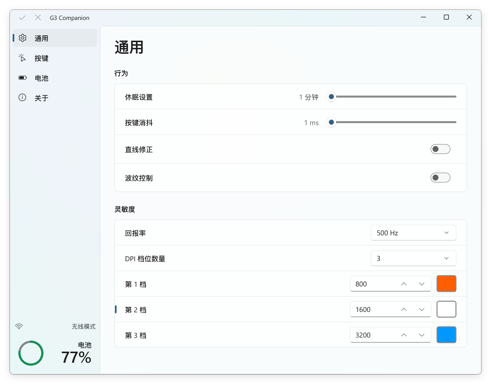
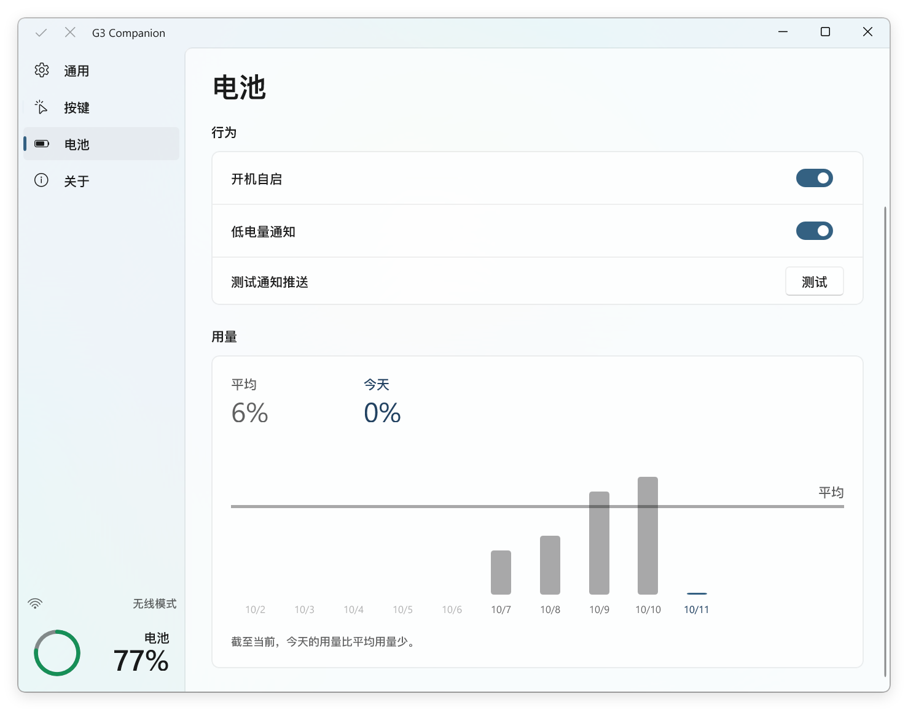
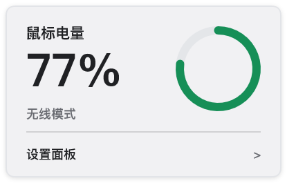
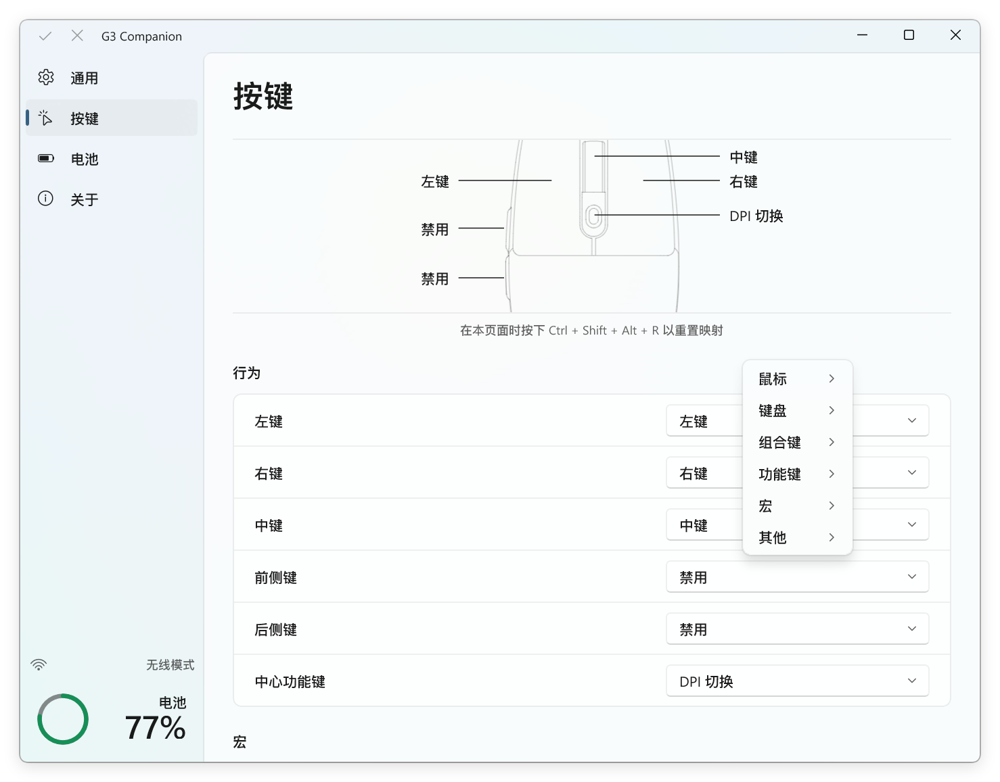
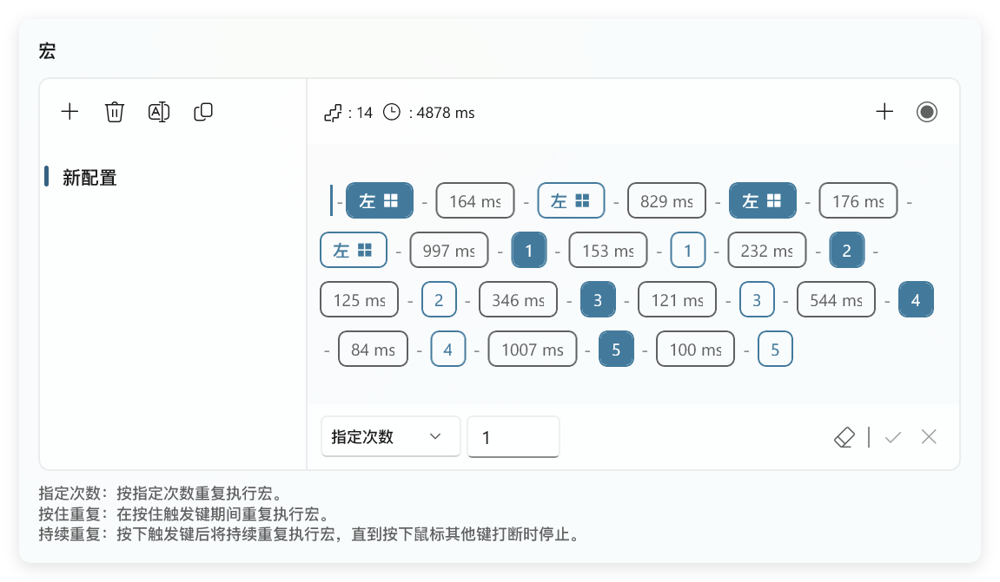

<p align="center">
  
</p>

<h1 align="center">G3 Companion</h1>

<p align="center">为迈从 G3 定制的第三方管理工具。</p>
<p align="center">通过 WinUI 3 界面管理鼠标参数、按键映射、宏与电量监控。</p>

<p align="center">
  
  
  
  <a href="LICENSE"></a>
</p>

<p align="center">
  <a href="README.md">English</a> · <a href="README.zh-CN.md">简体中文</a>
</p>

<p align="center">
  <a href="https://github.com/SsenNChan/G3-Companion/releases">下载</a> ·
  <a href="#功能">功能</a> ·
  <a href="#开始使用">开始使用</a> ·
  <a href="#从源码构建">从源码构建</a>
</p>



## 功能

### 电量监控

电量监控是 G3 Companion 的特色功能，原厂软件未提供这项功能。它整合托盘电量显示、低电量通知与每日用量统计。

在系统托盘查看鼠标电量与连接状态，通过电池页面开启开机自启和低电量通知。

用量图表展示近十天的每日电量消耗，提供今日用量和平均用量对照。



<p align="center">
  
</p>

### 按键映射

为六个鼠标按键分配鼠标操作、键盘按键、组合键、功能键或宏。鼠标示意图展示各按键的当前映射，功能菜单按类别组织可选操作。



### 宏编辑

相比原厂软件，G3 Companion 的宏编辑逻辑直观、简洁。按键事件与延时以可视化序列呈现，录制、编辑和配置管理集中在同一编辑器中，带来顺滑的编辑体验。

录制键盘与鼠标操作，编辑事件和延时，创建、重命名或复制宏配置。将配置分配给鼠标按键，选择执行方式：

- **指定次数**：按指定次数重复执行宏。
- **按住重复**：在按住触发键期间重复执行宏。
- **持续重复**：重复执行宏，直到按下鼠标其他键打断。



### 宏执行时钟补偿（实验性）

宏执行时钟补偿是 G3 Companion 独有的实验性功能。它源于宏功能测试中发现的鼠标内部时钟计时偏差：宏的实际执行间隔与编辑器中的设定延时存在差异，偏差随着宏中的累计延时增加。

测量流程使用一段延时为 10 秒的测试宏，以计算机的高精度计时器记录实际间隔，根据设定时间与实测时间计算补偿倍率。

开启补偿后，程序在向鼠标发送宏配置时按倍率调整延时，使实际执行时间贴近设定值。编辑器与本地保存的宏配置保留用户填写的延时。

入口位于按键页面宏编辑区域下方的**宏执行时钟补偿**。点击**测量**完成校准，开启补偿并点击**应用**。

### 鼠标参数与 DPI 指示灯颜色

在通用页面设置鼠标灵敏度与行为。

原厂软件使用固定的几种预设 DPI 指示灯颜色。G3 Companion 支持为每个 DPI 档位的指示灯选择任意 RGB 颜色，通过颜色选择器或十六进制值指定。

| 设置 | 可选内容 |
| --- | --- |
| DPI | 1–6 档，范围 100–12000，步长 100，每档指示灯可设置任意 RGB 颜色 |
| 回报率 | 125、250、500 或 1000 Hz |
| 休眠设置 | 调整进入休眠前的空闲时间 |
| 按键消抖 | 调整按键消抖时间 |
| 运动处理 | 直线修正与波纹控制 |

## 开始使用

### 运行要求

- Windows 10 1809 或后续版本，x64。
- 迈从 G3 鼠标，通过 USB 线或无线接收器连接。
- Windows App Runtime 1.8 系列的 x64 运行时，版本 1.8.12 起。安装程序可从 [Microsoft Windows App SDK 下载页面](https://learn.microsoft.com/en-us/windows/apps/windows-app-sdk/downloads-archive#windows-app-sdk-18)获取。

### 下载与启动

1. 从 [Releases](https://github.com/SsenNChan/G3-Companion/releases) 下载 Windows x64 ZIP 压缩包。
2. 解压到一个文件夹，保持包内文件同处该目录。
3. 安装上述 Windows App Runtime，连接鼠标。
4. 运行 `G3-Companion.exe`，编辑设置或按键映射，通过**应用**按钮向鼠标提交修改。
5. 在电池页面开启**电量监控**，使用托盘监控、低电量通知和用量记录。

设置、宏配置与电量记录保存在程序目录。

### 界面语言

程序在中文 Windows 显示语言下使用中文，在其余显示语言下使用英文。通过启动参数选择界面语言，在程序目录的 PowerShell 中执行其中一条命令：

```powershell
.\G3-Companion.exe --lang=en-US
.\G3-Companion.exe --lang=zh-CN
```

## 从源码构建

项目使用 C++20、C++/WinRT 和 WinUI 3。构建需要安装 Visual Studio 的 **使用 C++ 的桌面开发**工作负载、**MSVC v145** 工具集和 **Windows SDK 10.0.26100.0**。

在仓库根目录的 PowerShell 中执行：

```powershell
.\source\build.cmd "$PWD\.build"
```

[构建脚本](source/build.cmd)生成语言资源，下载 [packages.config](source/winui_manager/packages.config) 中的 NuGet 依赖，构建 Release x64，并将可执行文件与配套文件复制到仓库根目录。编译产物与依赖存放在 `.build`。

## 许可证

本项目采用 [GNU General Public License v3.0](LICENSE)（`GPL-3.0-only`）。应用图标中的第三方素材沿用 [第三方许可声明](THIRD_PARTY_NOTICES.md) 中的 MIT 许可证。

## 反馈

通过 [GitHub Issues](https://github.com/SsenNChan/G3-Companion/issues) 提交问题或功能建议。问题报告请包含程序版本、连接方式与复现步骤。
